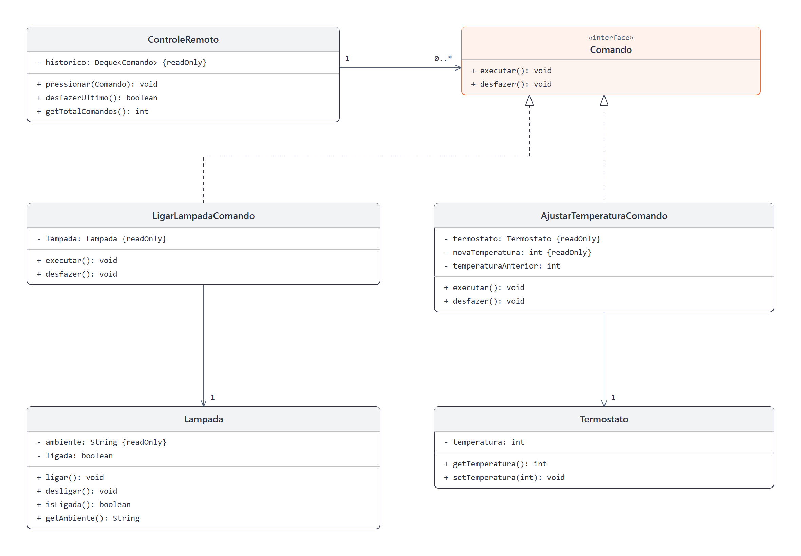

# DCC078 - Padrões de Projeto: Command

**Aluno:** Felipe Lazzarini Cunha

## Tema

O projeto representa um controle remoto de automação residencial que liga lâmpadas e ajusta a temperatura. O Command encapsula cada ação em um objeto com `executar()` e `desfazer()`, desacopla o controle dos dispositivos e permite desfazer os comandos na ordem inversa.

## Diagrama de Classes UML



## Estrutura do Projeto

- `Comando`: interface com as operações `executar()` e `desfazer()`.
- `LigarLampadaComando` e `AjustarTemperaturaComando`: comandos concretos que chamam os receptores.
- `Lampada` e `Termostato`: receptores que realizam as ações.
- `ControleRemoto`: invocador que executa os comandos e mantém o histórico para desfazer.

## Testes

Com JDK 11 ou superior e Maven:

```bash
mvn test
```
